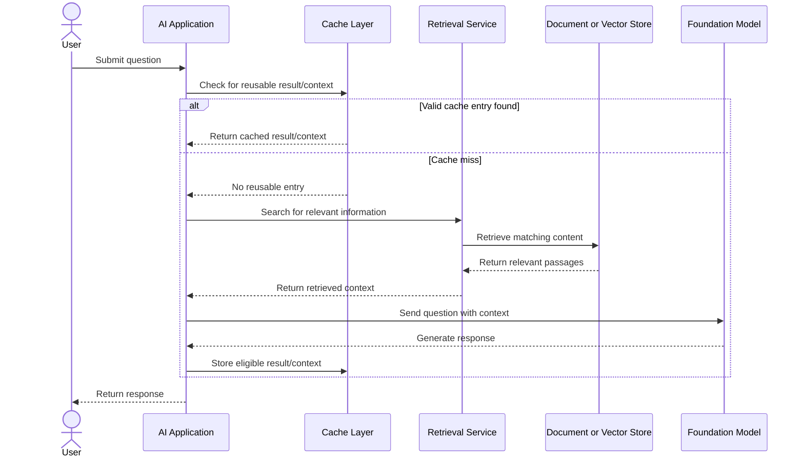

# UML Sequence Diagram 2: Intelligent Caching and Retrieval

## Purpose
Conceptual request path that checks a cache before retrieving information and invoking a model. Exact behavior depends on application design.

## Main Components
- **AI Application:** Orchestrates cache, retrieval, and model calls.
- **Cache Layer:** Reuses eligible cached information when valid.
- **Retrieval Service:** Finds relevant context.
- **Document or Vector Store:** Stores searchable source content.
- **Foundation Model:** Generates a response when inference is required.

## Design Considerations
- Apply cache freshness and invalidation rules.
- Do not reuse cached results when permissions or request context make them inappropriate.
- Evaluate retrieval relevance and latency.
- Cache only information safe and appropriate to reuse.

## Presentation Connection
Presentation 2: **Intelligent Caching Systems, Responsive AI & Retrieval Performance**.

*This is a conceptual learning diagram, not a verified deployed architecture.*
