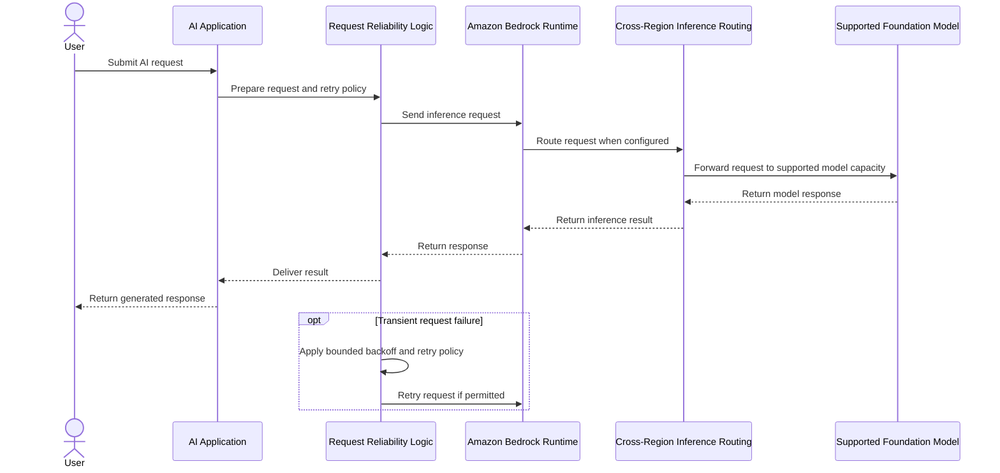

# UML Sequence Diagram 3: Amazon Bedrock Inference and Cross-Region Routing

## Purpose
Conceptual application-to-model inference sequence with an optional Cross-Region Inference routing step. Actual behavior depends on configuration, model support, and AWS Region.

## Main Components
- **AI Application:** Sends the inference request and handles the response.
- **Request Reliability Logic:** Implements suitable timeout, retry, and backoff behavior.
- **Amazon Bedrock Runtime:** Receives inference requests.
- **Cross-Region Inference Routing:** Represents routing when supported and configured.
- **Supported Foundation Model:** Processes the request.

## Design Considerations
- Confirm Cross-Region Inference support for the model and configuration.
- Review Region availability and applicable data governance or residency requirements.
- Use bounded retries and avoid retrying non-retryable errors.
- Verify current AWS behavior before implementation.

## Presentation Connection
Presentation 3: **Amazon Bedrock Optimization, System Performance & Cross-Region Inference**.

*This is a conceptual learning diagram, not a verified deployed architecture.*
